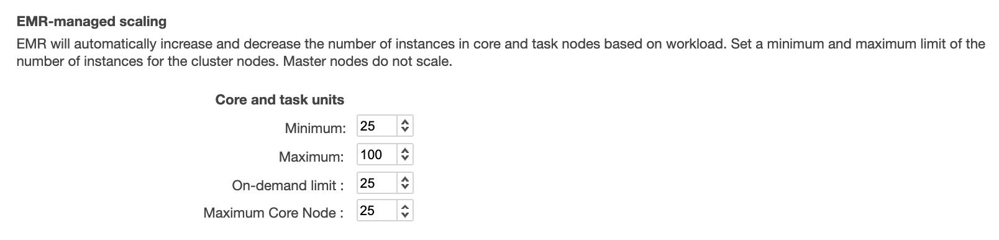
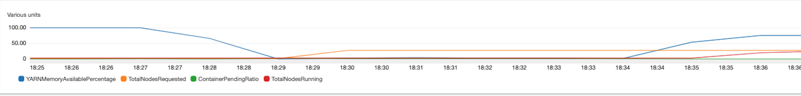

# Managed Scaling

[Managed scaling](https://docs.aws.amazon.com/emr/latest/ManagementGuide/emr-managed-scaling.html) lets you automatically increase or decrease the number of instances or units in your cluster based on workload. Amazon EMR continuously evaluates cluster metrics to make scaling decisions that optimize your clusters for cost and speed. Managed scaling is available for clusters composed of either instance groups or instance fleets.

## Keep core nodes constant and scale with only task nodes

Scaling solely based on task nodes enhances the speed at which nodes join or leave the cluster due to their lack of involvement in managing HDFS storage.
During the addition of more nodes to the cluster (scale up), task nodes avoid the necessity of installing data node daemons. Similarly, upon removal of nodes (scale down), task nodes escape the requirement of participating in HDFS block redistribution activities. These optimizations lead to enhanced performance through reduced scaling times and lower operational costs.

On the other hand, when diminishing the quantity of core nodes, there exists a danger of overwhelming the remaining nodes' disk volumes during HDFS rebalance. Should any node reach a 90% disk utilization rate, it could be flagged as unhealthy, effectively excluding it from YARN's purview.

In order to only scale with task nodes, you keep the number of core nodes constant and right size your core node EBS volumes for your HDFS usage. Remember to consider the HDFS replication factor which is configured via dfs.replication in hdfs-site.xml. It is recommended that at a minimum, you keep 2 core nodes and set dfs.replication=2.

Below is a managed scaling configuration example where the cluster will scale only on task nodes. In this example, the minimum nodes is 25, maximum 100. Of the 25 minimum, they will be all on-demand and core nodes. When the cluster needs to scale up, the remaining 75 will be task nodes on spot.



### With node labels: drivers on CORE, executors on TASK

With Amazon EMR 7.2 and later, when a cluster uses Managed Scaling with node labels, Managed Scaling scales application process (driver/ApplicationMaster) demand and executor demand independently ([Understand node types in Amazon EMR](https://docs.aws.amazon.com/emr/latest/ManagementGuide/emr-master-core-task-nodes.html#emr-plan-task), [Understanding node allocation strategy and scenarios](https://docs.aws.amazon.com/emr/latest/ManagementGuide/managed-scaling-allocation-strategy.html)). If drivers are restricted to CORE and executors run on TASK, CORE grows with driver demand and TASK grows with executor demand.

To restrict drivers to CORE (EMR 7.0 and later), add these properties to the `yarn-site` configuration classification:

```json
[
  {
    "Classification": "yarn-site",
    "Properties": {
      "yarn.node-labels.enabled": "true",
      "yarn.node-labels.am.default-node-label-expression": "CORE"
    }
  }
]
```

Shrinking CORE capacity is more conservative than shrinking TASK. While applications are running, CORE is only reduced after a sustained quiet period: no pending containers anywhere in the cluster, no pending applications, and enough free YARN memory. Pending executor requests count as pending containers here, even though they will never run on CORE. On clusters where applications keep requesting executors, that quiet period may not come, and CORE capacity will maintain its recent high for as long as work keeps arriving even if there are idle core nodes (see [CORE not scaling down while applications run](./troubleshooting#core-not-scaling-down-while-applications-run)).

Letting CORE flex with driver demand is worth considering when all of these are true:

- Concurrency varies significantly (for example 2 applications at night and 60 during working hours).
- The workload has regular quiet periods of at least 10 minutes, during which applications have finished and no new executors are requested.
- You can accept CORE staying at its high-water mark while any work keeps arriving.
- HDFS usage on CORE is small. Removing a CORE node means decommissioning its HDFS DataNode as well as its YARN NodeManager, and its blocks have to be re-replicated to the remaining CORE nodes before it can leave. With a large amount of HDFS data this makes CORE scale-down slow, and heavy HDFS write I/O delays it further. If the remaining nodes don't have room for the data, EMR decommissions only some of the nodes, and nodes that pass 90% disk utilization are marked unhealthy and stop running YARN containers. CORE can also never shrink below `dfs.replication` nodes ([Cluster scale-down options](https://docs.aws.amazon.com/emr/latest/ManagementGuide/emr-scaledown-behavior.html)).

Good fits are scheduled batch clusters that drain between windows, short-lived clusters, and interactive or notebook clusters with predictable downtime (e.g., overnight when most sessions are idle or closed). Poor fits are clusters that combine long-running jobs, such as streaming or always-on pipelines, with any other workload: in this case the long-running jobs keep requesting executors, and that will stop CORE capacity from scaling in.

For multi-user clusters (say 20 to 100+ concurrent users or applications) without regular downtime, the suggestion would be to keep CORE fixed and put the elasticity on TASK:

1. Set `MaximumCoreCapacityUnits` to the CORE capacity you launch with, and `MinimumCapacityUnits` at least that large, so Managed Scaling never needs to shrink CORE. If `MaximumCoreCapacityUnits` is unset it defaults to `MaximumCapacityUnits`, so CORE can grow to the size of the whole cluster and then be held there.

2. Size CORE from the driver (ApplicationMaster) container:

   ```
   CORE nodes = ceil( D / drivers_per_node ) + H
   drivers_per_node = floor( min( M_node / M_AM , V_node / V_AM ) )
   ```

   - `D` is the number of concurrent drivers you want to start without waiting. Each running YARN application has one ApplicationMaster, so the `AppsRunning` CloudWatch metric is a direct count of concurrent drivers. Plot its Maximum at a 1-minute period over a representative week (include your busiest day), and add `AppsPending` if applications were already queuing. Use the peak of that line if every driver must start immediately. If you can accept some applications waiting for a driver slot at busy times, use the p90 (or the average) of `AppsRunning` instead: applications above that level wait in ACCEPTED until a running application finishes and frees its slot.
   - `M_node` and `V_node` are `yarn.nodemanager.resource.memory-mb` and `yarn.nodemanager.resource.cpu-vcores` on the CORE instance type. `M_AM` and `V_AM` are the ApplicationMaster container's memory (including overhead) and vCores: the driver in cluster mode, or `spark.yarn.am.memory`/`spark.yarn.am.cores` in client mode. The vCore term only applies if the Capacity Scheduler uses the DominantResourceCalculator; otherwise you only need to use memory values.
   - `H` is headroom you choose, for example to cover a CORE node being replaced or ApplicationMaster retries. Set it from how much queueing you can tolerate; there is no fixed rule of thumb here.
3. Right-size drivers so that two or more fit on a CORE node where you can. This is the most powerful lever to reduce the CORE capacity you need.
4. Run executors on TASK (labelled TASK, or unlabelled with an exclusive CORE label), on Spot where the workload tolerates potential node loss, with dynamic allocation enabled.
5. If CORE must flex, cap `MaximumCoreCapacityUnits` near the peak driver need. CORE will still be held at its recent high while busy, but no higher than the cap.

Example for an r7g.xlarge CORE (`yarn.nodemanager.resource.memory-mb` 23424, the [default without HBase](https://docs.aws.amazon.com/emr/latest/ReleaseGuide/emr-hadoop-task-config.html#emr-hadoop-task-config-r7g)) with a 5632 MB driver container (4 drivers per node), one unit per node, and `H = 2`:

| Peak concurrent drivers | CORE nodes | Policy |
|---|---|---|
| 20 | 7 | Min 7, MaxCore 7 |
| 50 | 15 | Min 15, MaxCore 15 |
| 100 | 27 | Min 27, MaxCore 27 |

In each case, set `MaximumCapacityUnits` high enough to cover CORE plus your peak TASK capacity.

With an 11712 MB driver container (2 per node), the same peaks need 12, 27 and 52 CORE nodes.

## Monitor Managed Scaling with Cloudwatch Metrics

You can monitor your managed scaling cluster with CloudWatch metrics. This is useful if you want to better understand how your cluster is resizing to the change in job load/usage. Lets looks at an example:



At 18:25, `YARNMemoryAvailablePercentage` starts at 100%. This means that no jobs are running. At 18:27 a job starts and we see `YARNMemoryAvailablePercentage` begin to drop, reaching 0% at 18:29. This triggers managed scaling to start a resize request - represented by the increase in the metric `TotalNodesRequested`. After 5-6 mins, at 18:35 the nodes finish provisioning and are considered `RUNNING`. We see an increase in the metric, `TotalNodesRunning`. Around the same time, we see `YARNMemoryAvailablePercentage` begin increasing back to 100%.

For a full list of metrics and description of each, see [Understanding managed scaling metrics in Amazon EMR](https://docs.aws.amazon.com/emr/latest/ManagementGuide/managed-scaling-metrics.html).

## Consider adjusting YARN decommissioning timeouts depending on your workload

There are two decommissioning timeouts that are important in managed scaling:

1. *`yarn.resourcemanager.nodemanager-graceful-decommission-timeout-secs`* This is the maximal time to wait for running containers and applications to complete before transition a `DECOMMISSIONING` node into `DECOMMISSIONED`.
2. *`spark.blacklist.decommissioning.timeout`* This is the maximal time that Spark does not schedule new tasks on executors running on that node. Tasks already running are allowed to complete.

When managed scaling triggers a scale down, YARN will put nodes it wants to decomission in a `DECOMMISSIONING` state. Spark will detect this and add these nodes to a “black list” (_AWS acknowledges the use of non-inclusive language in this codebase and will work with the Spark community to update_). In this state, Spark will not assign any new tasks to the node and once all tasks are completed, YARN will finish decommissioning the node. If the task runs longer than *`yarn.resourcemanager.nodemanager-graceful-decommission-timeout-secs`*, the node is force-terminated and the task will be reassigned to another node.

In certain scale down scenarios where you have long running tasks, many nodes can end up in this state where they are `DECOMMISSIONING` and `blacklisted` because of *`spark.blacklist.decommissioning.timeout.`* You may observe that new jobs run slower because it cannot assign tasks to all nodes in the cluster.

To mitigate this, you can lower *`spark.blacklist.decommissioning.timeout`* to make the node available for other pending containers to continue task processing. This can improve job run times. However, please take the below into consideration:

* If a task is assigned to this node, and YARN transitions from `DECOMMISSIONING` into `DECOMMISSIONED`, the task will fail and will need to be reassigned to another node.
* Spark blacklist also protects from bad nodes in the cluster, e.g., faulty hardware leading to high task failure rate. Lowering the blacklist timeout can increase task failure rate since tasks will continue to be assigned to these nodes.

Nodes can be transitioned from `DECOMMISSIONING` to `RUNNING` due to a scale up request. In this scenario, tasks will not fail and with a lower blacklist timeout, pending tasks can continuously be assigned to the node.

With *`yarn.resourcemanager.nodemanager-graceful-decommission-timeout-secs`*, consider increasing this from the default of 1hr to the length of your longest running task. This is to ensure that YARN does not force-terminate the node while the task is running, causing it to re-run on another node. The cost associated with rerunning the long running task is generally higher than keeping the node running to ensure it's completed.

For more information, see:

* [Configuring node decommissioning behavior](https://docs.aws.amazon.com/emr/latest/ReleaseGuide/emr-spark-configure.html#spark-decommissioning)
* [Spark enhancements for elasticity and resiliency on Amazon EMR](https://aws.amazon.com/blogs/big-data/spark-enhancements-for-elasticity-and-resiliency-on-amazon-emr/)
* [Amazon EMR cluster error: Deny-listed nodes](https://docs.aws.amazon.com/emr/latest/ManagementGuide/emr-troubleshoot-error-resource-3.html)

## EMR Managed Scaling compared to Custom Automatic Scaling

The following [document](https://docs.aws.amazon.com/emr/latest/ManagementGuide/emr-scale-on-demand.html) highlights the key differences between EMR managed scaling vs. custom automatic scaling.

In general, we recommend using EMR managed scaling since the metric evaluation is every 5-10 seconds. This means your EMR cluster will adjust quicker to the change in the required cluster resources. In addition, EMR managed scaling also supports instance fleets and the the scaling policy is simpler to configure because EMR managed scaling only requires min and max amounts for purchasing options (On-Demand/Spot) and node type (core/task).

Custom automatic scaling should be considered if you want autoscaling outside of YARN applications or if you want full control over your scaling policies (e.g., evaluation period, cool down, number of nodes)

## Configure Spark History Server (SHS) custom executor log URL to point to Job History Server (JHS) Directly

When you use SHS to access application container logs, YARN ResourceManager relies on the NodeManager that the jobs' Application Master (AM) ran on, to redirect to the JHS. The JHS is what hosts the container logs. A job's executor logs cannot be accessed if the AM ran on a node that’s been decommissioned due to managed scaling or spot.

A solution to this is pointing SHS to the JHS directly, instead of letting node manager redirect.

Spark 3.0 introduced *spark.history.custom.executor.log.url*, which allows you to specify a custom Spark executor log url.
You can configure *spark.history.custom.executor.log.url* as below to point to JHS directly:

```
{{HTTP_SCHEME}}<JHS_HOST>:<JHS_PORT>/jobhistory/logs/{{NM_HOST}}:{{NM_PORT}}/{{CONTAINER_ID}}/{{CONTAINER_ID}}/{{USER}}/{{FILE_NAME}}?start=-4096
```

Replace `JHS_HOST` and `JHS_PORT` with actual values. `JHS_HOST` is the EMR master node.
